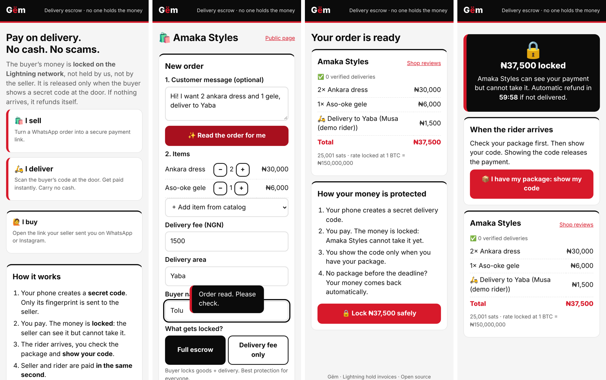
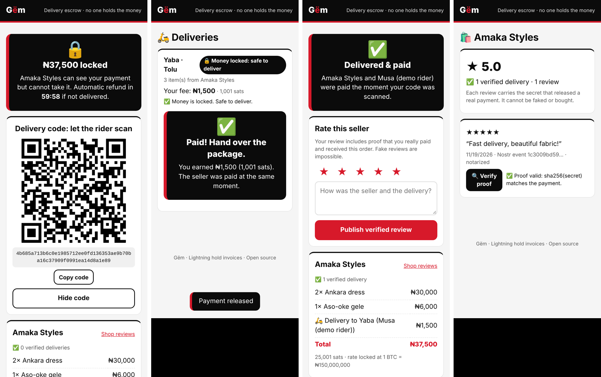
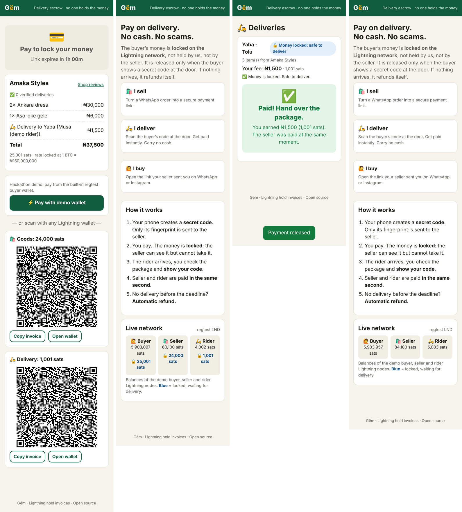
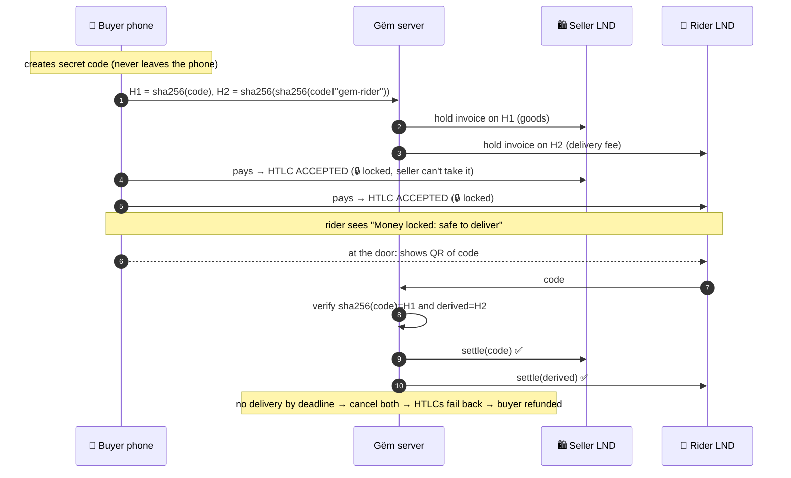

# Gëm: pay on delivery, without cash, without a middleman

> *Gëm* means "to trust" in Wolof.
> **Dakar Bitcoin Hack by BTrust, 2026**

Online shopping on Instagram and WhatsApp in Lagos and Dakar runs on **cash on delivery**, because buyers and sellers don't trust each other:

- **Buyers** won't pay first: some sellers take the money and disappear.
- **Sellers** lose money on **fake orders**: the rider crosses the city and nobody picks up.
- **Riders** carry cash all day, get robbed, and sellers wait days to receive it.

The usual fix is an escrow company that holds the money. That company must be trusted and licensed, and it can freeze or lose the funds.

**Gëm locks the buyer's payment on the Lightning Network itself.** Nobody holds it: not us, not the seller. It is released only when the buyer shows a secret code at the door. If nothing arrives before the deadline, it **refunds itself**.





## Why it has to be Bitcoin

Lightning **hold invoices** (HTLCs) give us something cash, mobile money and bank transfers cannot:

| | Cash on delivery | Mobile money | Escrow company | **Gëm (Lightning)** |
|---|---|---|---|---|
| Seller sees proof funds exist before shipping | ❌ | ❌ | ✅ | ✅ |
| Seller can't take money before delivery | ✅ | ❌ | ✅ (trust the company) | ✅ **(enforced by cryptography)** |
| Automatic refund, no support ticket | n/a | ❌ | ❌ | ✅ |
| No custodian / no license | ✅ | ❌ | ❌ | ✅ |
| Rider carries no cash | ❌ | ✅ | ✅ | ✅ |
| Rider paid in the same second, no middleman cut | ❌ | ❌ | ❌ | ✅ |
| Works across borders (Lagos ⇄ Dakar) | ❌ | ❌ | rarely | ✅ |

## How it works



**One code, two payments.** Wallets refuse to pay two invoices with the same hash, so the rider's secret is *derived* from the buyer's code. The buyer still shows one QR, and seller and rider are paid in the same second.

## Features

- **WhatsApp checkout link:** the seller pastes the customer's message; the order is read for them (an AI model on Groq's free tier, or a built-in rule parser offline); a **💬 Send on WhatsApp** button shares a secure link. The buyer needs no app or account.
- **Escrow without custody:** hold invoices on the seller and rider nodes; the server stores only hashes.
- **Rider paid by the same code:** delivery fee locked separately and released together with the goods.
- **Automatic refund:** a watchdog cancels anything past its deadline, long before the HTLC's on-chain timeout, so channels never force-close.
- **Deposit-only mode:** lock only the delivery fee (goods in cash). Ends fake orders and gives sellers an easy first step.
- **Verified reviews on Nostr:** a review carries the payment preimage. Anyone can check `sha256(preimage) == payment_hash` in their browser, so **a review can't exist without a real, completed delivery**. Signed with the buyer's own key if a NIP-07 extension exists, otherwise notarized.
- **Inspect at the door:** the buyer taps "🛵 The rider is here", opens the package with a checklist and a 5-minute guide timer, and only then taps "✅ Package OK" to show the code. "❌ Something is wrong" explains that without the code nobody can take the money (seller cancel → instant refund, or automatic refund at the deadline).
- **English, French and Wolof:** one tap in the header (EN · FR · WO), remembered on the phone; defaults to the phone's language. WhatsApp messages are sent in the chosen language too.
- **Rider feels the payment:** a short beep and vibration on "Paid", so the rider doesn't have to stare at the screen at the door.
- **Seller catalog editor:** add items, edit prices, remove items, and add the words customers use ("zobo", "bissap") so the order reader recognises them. Prices stay seller-controlled and are snapshotted into each order.
- **Local currency first:** ₦ / F CFA in large type, sats in small type, rate locked at order time.
- **Built for low bandwidth:** no framework, no build step, ~40 KB of JS, works on mid-range Android over 3G.

## Run it

### One command (full Lightning network)

Requires Docker.

```bash
./start.sh
```

This starts **bitcoind (regtest) + 3 LND nodes (buyer, seller, rider) + the app**, mines blocks, funds the buyer and opens channels. Then open **http://localhost:3000**.

```bash
./scripts/mine.sh 6        # mine blocks if needed
./stop.sh                  # stop (keeps data)
./stop.sh --reset          # wipe chain, nodes and orders
docker compose exec backend node test/lnd.integration.js   # integration test against the real nodes
```

### Without Docker (simulated Lightning, 30 seconds)

```bash
cd backend
npm install
npm start                  # LN_BACKEND=mock by default
npm test                   # end-to-end, i18n, AI and security tests
```

The mock backend implements the same hold-invoice state machine (OPEN → ACCEPTED → SETTLED | CANCELED), so every screen works.

### Demo script (happy path)

1. `/seller`: create a shop → paste *"Hi! I want 2 ankara dress and 1 gele, deliver to Yaba"* → **Read the order** → **Create payment link**.
2. Open the link (buyer) → **Lock** → **Pay with demo wallet**. Watch the home page: 🔒 sats locked on the seller and rider nodes.
3. Buyer taps **I have my package: show my code**.
4. `/rider` → **Scan delivery code** (camera, or paste the code) → **✅ Paid! Hand over the package**.
5. Buyer leaves a review → open the shop page → **🔍 Verify proof**.

**Refund path:** lock and pay a second order, then press **↩️ Refund buyer** on the seller page, or set `LOCK_MINUTES=2` and wait.

### Deploy on Render with real Lightning

`render.yaml` deploys **gem-lnd**: bitcoind (regtest) + 3 LND nodes + Gëm in one container with a persistent disk (Starter plan), plus a free simulated backup. Step by step: [docs/deploy-render.md](docs/deploy-render.md).

### Public link from your laptop (real Lightning, free)

`./tunnel.sh` runs the full regtest stack on your computer and prints a free public `https://….trycloudflare.com` link (Cloudflare quick tunnel). Works while the laptop stays awake and online. Step by step: [docs/deploy-laptop.md](docs/deploy-laptop.md).

### Deploy on real Lightning (VPS)

`./deploy.sh` on any Docker server puts the full regtest stack (bitcoind + 3 LND nodes + Gëm) online behind HTTPS, with a free `sslip.io` address or your own domain. Step by step: [docs/deploy-vps.md](docs/deploy-vps.md).

### Deploy (Render free plan, simulated Lightning only)

The repo includes `render.yaml`. In Render: **New → Blueprint → pick this repo**, then fill in `GROQ_API_KEY` (optional) when asked. It runs with simulated Lightning, so no nodes or keys are needed, and Render provides HTTPS (required for the rider's camera).

- The free plan sleeps after 15 minutes idle (first visit takes ~1 minute) and has no disk, so shops and orders reset on restart. A paid plan with the disk block in `render.yaml` keeps them.
- Vercel and other serverless hosts don't fit: Gëm needs a long-running process for the refund watchdog and a disk for its data.
- Any other Node host works the same way: root `backend`, build `npm ci --omit=dev`, start `node src/server.js`, and set `TRUST_PROXY=1` when behind the host's proxy.

## Configuration (`.env`)

| Variable | Default | |
|---|---|---|
| `CURRENCY` | `NGN` | `NGN` or `XOF`; switches the demo catalog too |
| `BTC_PRICE_LOCAL` | `150000000` | 1 BTC in local currency |
| `LOCK_MINUTES` | `60` | auto-refund deadline |
| `TRUST_PROXY` | `0` | number of proxies in front of the app (`1` on Render/Railway/Fly) so rate limits see the real client IP |
| `GROQ_API_KEY` | – | optional, enables AI order reading (free key at console.groq.com) |
| `GROQ_MODEL` | `openai/gpt-oss-20b` | optional, any Groq chat model |
| `NOSTR_RELAYS` | – | optional, e.g. `wss://relay.damus.io,wss://nos.lol` |

## Architecture

```
backend/
  src/server.js            Express API + static frontend, security headers, rate limits
  src/orders.js            escrow state machine, watchdog, settle/cancel logic
  src/lightning/lnd.js     LND REST client (hold invoices, least-privilege macaroons)
  src/lightning/mock.js    in-memory Lightning with identical semantics
  src/ai.js                order parsing (Groq AI → validated → catalog prices) + rule fallback
  src/nostr.js             verified-review events (sign / verify / publish)
  public/                  vanilla JS PWA: seller, buyer (/o/:id), rider, shop (/s/:id)
  test/e2e.test.js         6 tests (mock)
  test/lnd.integration.js  real-LND test: lock → settle, lock → expire → refund
docs/threat-model.md       security design
docs/pitch.md              3-minute pitch script
```

## Constraints, stated honestly

- **Lock window is hours, not weeks.** Hold invoices tie up channel liquidity and must resolve before the HTLC timeout (144 blocks ≈ 24 h). Gëm targets **same-day city delivery**, which is how Instagram sellers already work.
- **Buyers need sats.** Deposit-only mode lowers the barrier; on/off-ramps are out of scope.
- **Demo shortcut:** the server holds the seller/rider invoice macaroons and a demo buyer wallet. In production each party connects their own node or wallet (e.g. NWC with hold-invoice support); see the threat model.
- **Price risk:** small, because funds are locked for hours. Future: stablecoin payments over Lightning (Taproot Assets).

## Metrics to track

- Orders locked / delivered / refunded per week (and refund reasons)
- Fake-order rate vs. the seller's cash-on-delivery baseline
- Median time from lock to settle; rider cash carried (target: 0)
- Verified reviews per seller; repeat buyers

## Next iteration

1. Each party brings their own wallet (NWC / LNbits / Breez SDK), with no server-held macaroons
2. Offline rider mode (scan now, settle when back online)
3. Voice prompts; Wolof copy reviewed by native speakers (the current Wolof is a first draft)
4. Cross-border orders (Lagos seller → Dakar buyer)
5. Group buys: the order happens only if every buyer locks

## License

MIT. Built in public for the Dakar Bitcoin Hack.
